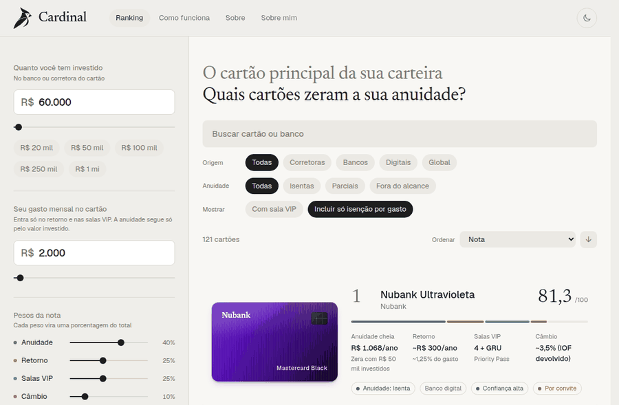
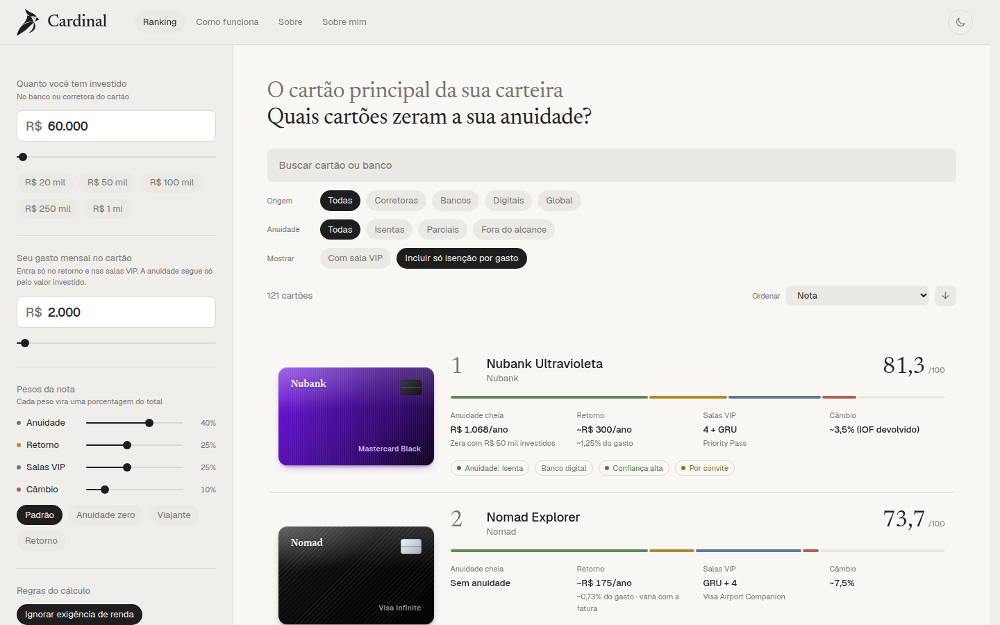
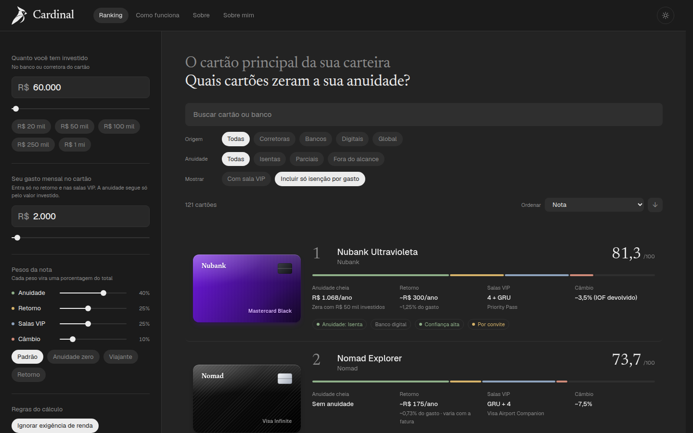
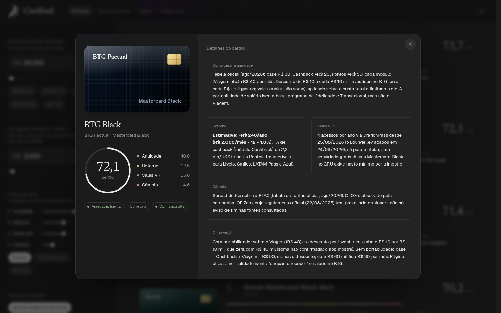
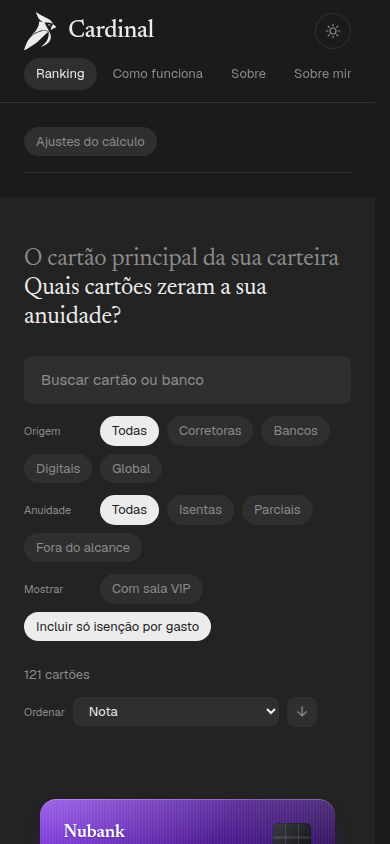

# Cardinal

O cartão principal da sua carteira. Comparador de cartões de crédito premium (corretoras, bancos, digitais e globais) que mostra quais zeram a anuidade pelo valor investido e quanto sobra de retorno, salas VIP e câmbio com o seu gasto mensal.

Monorepo em TypeScript: um front em React, uma API em Node com banco SQLite e um pacote com os contratos que os dois compartilham.



| Tema claro | Tema escuro |
|---|---|
|  |  |

| Detalhe do cartão | Celular |
|---|---|
|  |  |

## Estrutura

```
apps/
  web/      React 19 + Vite + Sass (CSS Modules), React Router, Zustand e TanStack Query
  api/      Express 5 + Drizzle ORM + SQLite, em camadas
packages/
  shared/   schemas Zod, tipos inferidos e as regras numéricas usadas pelos dois lados
```

## Rodando

Node 22 (há um `mise.toml` na raiz).

```bash
npm install
npm run dev        # API em http://localhost:3001 e web em http://localhost:5173
```

Na primeira subida a API cria o banco (`apps/api/data/cardinal.sqlite`), aplica as migrações e popula os cartões. O Vite encaminha `/api` para a API, então não há CORS no desenvolvimento.

| Comando | O que faz |
|---|---|
| `npm run dev` | sobe API e web juntas |
| `npm run lint` · `npm run typecheck` | ESLint e TypeScript nos três pacotes |
| `npm test` | testes da API, do front e do shared |
| `npm run build` | build de produção da API (`apps/api/dist`) e do front (`apps/web/dist`) |
| `npm run db:migrate` · `npm run db:seed` | migra o banco e recria os dados de `apps/api/src/db/seed` |

Variáveis da API (todas opcionais, veja `apps/api/.env.example`): `PORT`, `DATABASE_PATH`, `CORS_ORIGIN`, `LOG_LEVEL`, `SEED_ON_START`, `RATE_LIMIT_PER_MINUTE`. No front, `VITE_API_URL` troca o endereço base da API (padrão `/api`).

## Como as peças conversam

```
React (apps/web)                         Express (apps/api)
  Zustand: cenário e filtros  ──┐
  TanStack Query: cache, erro,  ├─ POST /api/ranking ─▶ routes → controllers → services → repositories → SQLite
  carregamento e skeleton     ──┘                        └─ domain/: anuidade, nota, filtro e ordenação
                         ▲  validados com os mesmos schemas Zod (packages/shared)
```

- **Estado do cliente** (Zustand): o cenário (aporte, gasto, pesos, regras), salvo no navegador, e os filtros e a ordenação, que sobrevivem à troca de página.
- **Estado do servidor** (TanStack Query): o ranking, o detalhe de cada cartão e as contagens. A tela mostra skeleton na primeira carga, mantém a lista anterior (esmaecida) enquanto atualiza, tenta de novo erros de rede e do servidor, não repete erro de cliente e pré-carrega o detalhe quando você passa o mouse no cartão.
- **Contrato único**: `packages/shared` define os schemas Zod. A API valida a entrada com eles, o front valida a resposta, e os tipos TypeScript são inferidos dos mesmos schemas.
- **Skeleton e tema**: as cores do skeleton são tokens da paleta (`--skeleton` e `--skeleton-shine`), definidos para o tema claro e o escuro, e a animação respeita `prefers-reduced-motion`.

## API

| Rota | O que faz |
|---|---|
| `GET /api/health` | liveness |
| `GET /api/meta` | total de cartões e quantos só zeram a anuidade por gasto |
| `GET /api/cards/:id` | cartão completo, com as fontes |
| `POST /api/cards/:id/score` | nota e anuidade de um cartão para um cenário |
| `POST /api/ranking` | ranking filtrado e ordenado para um cenário |

Exemplo:

```bash
curl -X POST http://localhost:3001/api/ranking -H 'content-type: application/json' -d '{
  "scenario": {
    "investment": 60000, "monthlySpend": 2000,
    "weights": { "annualFee": 40, "rewards": 25, "loungeAccess": 25, "exchangeRate": 10 },
    "hasSalaryPortability": true, "ignoreEntryRequirement": true
  }
}'
```

`filters` e `sorting` são opcionais (padrão: todos os cartões, por nota). Erros têm sempre o formato `{ "error": { "code", "message", "details?" } }`, com `400` para entrada inválida, `404` para recurso inexistente, `413` para corpo acima de 100 kb e `429` para excesso de requisições. A lista não carrega as fontes; elas vêm no detalhe do cartão.

## Banco de dados

SQLite via Drizzle ORM. O esquema (`apps/api/src/db/schema.ts`) tem a tabela `cards` e a tabela `card_sources` (uma linha por fonte, com `ON DELETE CASCADE`). As migrações em SQL ficam em `apps/api/drizzle` e são geradas com `npm run db:generate -w @cardinal/api` depois de mudar o esquema. A coluna `position` guarda a ordem original, porque o desempate do ranking depende dela. O acesso passa por uma interface (`CardsRepository`), então trocar o SQLite por outro banco é escrever uma nova implementação.

## Como a nota funciona

Cada cartão recebe de 0 a 100 em quatro critérios (anuidade, retorno, salas VIP e câmbio). A nota final é a média ponderada pelos pesos escolhidos na tela. As regras ficam em `apps/api/src/domain/` como funções puras, e os números fixos (R$ 1.500 para zerar a nota de anuidade, 2% para a nota máxima de retorno, etc.) em `packages/shared/src/rules.ts`, de onde a página "Como funciona" também lê.

## Testes

- **API**: a nota, a anuidade e o retorno dos 121 cartões em 20 cenários, e a ordem do ranking em 18 combinações de filtro e ordenação, são comparados com valores congelados a partir da versão em que o cálculo ainda rodava no navegador. Também há teste de ida e volta pelo banco, da API por HTTP (validação, erros, cabeçalhos, limite de uso) e de integridade dos dados.
- **Front**: cliente HTTP (todos os caminhos de erro) e store de filtros.
- **Shared**: limites, valores padrão e o que cada schema descarta.

## Sobre os dados

Os dados vêm de blogs especializados e, quando abriram, de páginas oficiais, com consulta em out/2026. Cada cartão traz a confiança (alta, média ou baixa) e as fontes, que aparecem no modal. Muitas páginas oficiais não abriram na pesquisa, então confirme com o emissor antes de decidir. Não é recomendação financeira.
